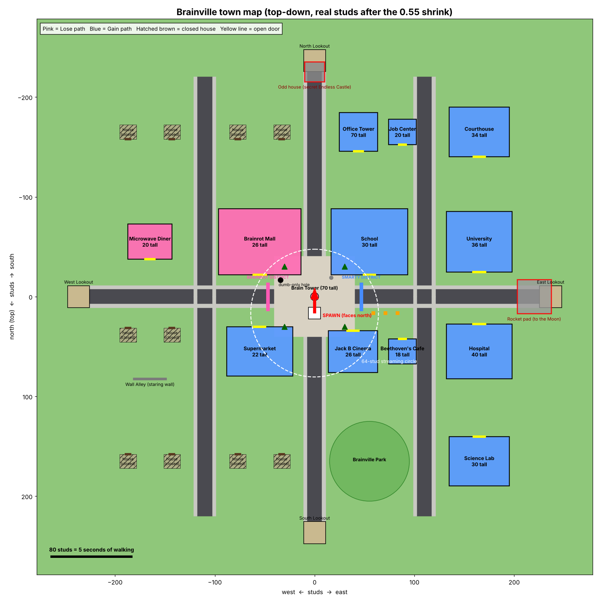
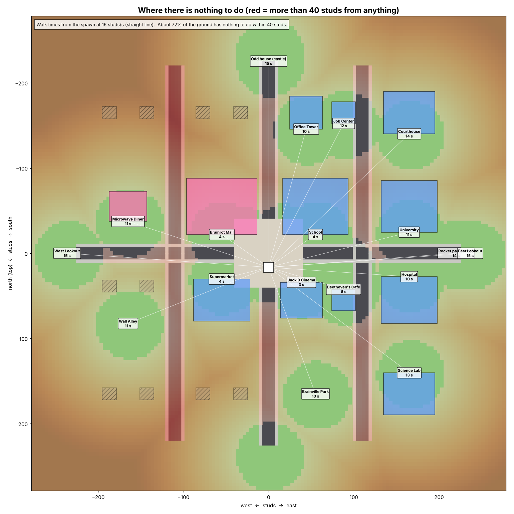

# Why the map feels off

You said the map feels wrong but you couldn't say why. Here's the why, measured from the real game code (`WorldService.lua`, `CastleService.lua`, `SpaceService.lua`), drawn from above and compared with the map rules in `docs/Brain scaled UI and map design.md`.

**The short answer:** the town is built like a **squashed spreadsheet**. Everything sits on a perfectly mirrored grid, everything was shrunk sideways to 55% but not shortened, and the left half is mostly empty locked houses. So the town feels **flat, samey, cramped in the middle and empty everywhere else**.

*Pink = Lose path, blue = Gain path, hatched brown = locked house, yellow line = open door. North is at the top. 80 studs = 5 seconds of walking.*

*Red = more than 40 studs from anything you can use. The labels show how many seconds it takes to walk there from the spawn.*

---

## The 8 reasons, most important first

### 1. Everything was squashed sideways, but not shortened
- **What you feel:** buildings look tall and skinny, doors look like slots, roads and sidewalks feel thin, and nothing feels "right-sized" next to your character.
- **Evidence:**
  - The whole town is made at full size and then shrunk to **55% wide and deep, but 100% tall** (`S = 0.55`).
  - The Office Tower is **38 studs wide but 70 tall**. The Hospital is 66 wide and 40 tall.
  - Doors are **13 studs tall but only 4.4 wide on houses** and 7–12 wide on shops. The guide's rule is at least 10 wide.
  - Roads are **15 studs wide** (the guide says 20–30), and sidewalks only **3.3 studs** (the guide says about 10).
- **Fix:** stop shrinking sizes. Keep the 0.55 for *positions* (so the town stays compact), but build buildings, doors, roads and sidewalks at their real size. Or shrink height by the same 0.55. Either way the proportions come back.

### 2. It's a perfect mirror grid, so every street looks the same
- **What you feel:** "Where am I?" Every corner looks like every other corner, and nothing pulls you anywhere.
- **Evidence:**
  - Every building sits on the same 4 spots in each quarter: x = ±55 / ±165 and z = ±55 / ±165.
  - Every building is the same shape: a rectangular box with one door, an awning and a sign.
  - The roads are a plus sign plus 4 parallel lines.
  - There are no curves, no hills, no different heights, no plazas besides the middle one, and no buildings turned at an angle.
- **Fix:** break the grid on purpose.
  - Give each district one special shape: a round Mall dome, a tall clock tower on the University, a wide low Diner with a giant microwave on the roof.
  - Turn a few buildings to face corners.
  - Add a curved park path and a small hill or steps.
  - Make one street narrow and busy (Brainrot Alley) and one wide and fancy (Smarty Boulevard).

### 3. The left (Lose) half is mostly locked houses
- **What you feel:** the Lose side is boring and dead. Smart players get a whole city, and dumb players get a mall, a diner and a wall.
- **Evidence:**
  - The west half has **3 open buildings + 10 locked houses**: the Mall, the Diner, and the Supermarket, which is a **Gain** job on the Lose side.
  - The east half has **9 open buildings + the park + the rocket**, and no locked houses.
  - **About 75% of the west half has nothing to do within 40 studs, compared with about 49% of the east half.** Over the whole ground it's about 72%.
  - The Lose places are only the Mall (4 s from spawn), the Diner (11 s) and Wall Alley (11 s).
- **Fix:**
  - Swap the Supermarket to the Gain side, or make it a Lose shop.
  - Turn some locked houses into Lose things: a Brainrot Arcade, a TV Shop with 100 screens, a "Bounce House of Bad Decisions", a Fortune Teller that's always wrong.
  - Delete the houses that will never open and fill the space with something you can use, like a fair, a skate park or a giant phone statue.
  - The CLAUDE.md rule says both paths matter equally, and right now the map breaks it.

### 4. The four buildings around the plaza crash into it
- **What you feel:** the middle feels cramped and messy. The plaza square isn't a clean square, and corners poke in.
- **Evidence:**
  - The plaza is 80×80 studs.
  - The Mall cuts into it by **26×18 studs**, the School by **24×18**, the Cinema by **26×6** and the Supermarket by **18×10**.
  - **Three plaza trees are planted *inside* the Mall, the School and the Supermarket** (at ±30, ±30).
- **Fix:**
  - Push those 4 buildings back about 25 studs, or make the plaza a bit smaller.
  - Move the trees to the plaza's real corners.
  - A clean square with 4 buildings facing it is one of the strongest town shapes there is.

### 5. Things are built on top of each other at the street ends
- **What you feel:** the edges look glitchy, with things clipping through each other.
- **Evidence:**
  - The **East Lookout overlaps the rocket launch pad by 11×22 studs**. Both are at the end of the east road.
  - The **North Lookout overlaps the odd house** (the secret Endless Castle entrance) by **20×10 studs**.
  - The Café and the Job Center stick **2.8 studs into the sidewalk** of the right-hand road.
- **Fix:**
  - Move the North Lookout to the south or west, or put it behind the odd house.
  - Move the rocket pad off the road into its own little space-port area with a fence.
  - Pull the Café and the Job Center back 3 studs.

### 6. Half the doors don't face a street, and some roads lead nowhere
- **What you feel:** you walk along a road and the buildings show you their sides or backs. The back row feels hidden, and some roads just end in grass.
- **Evidence:**
  - The Office Tower door is **36 studs** from the nearest road, and the Courthouse and Science Lab are **47 studs** away, facing open grass.
  - The two "ring" roads (x = ±110) aren't a ring: **nothing connects them across**, and all **4 of their ends stop in grass** with no lookout.
  - The back-row houses face empty grass too.
- **Fix:**
  - Add one cross street along the back row on each side (z = ±165), so every door faces a road.
  - Join the ring roads into a real loop.
  - Every road should end at something: a lookout, a statue or a building.

### 7. The town is too small for "walking is slow" to mean anything
- **What you feel:** the realistic phone says to take a taxi, but walking is faster, so Hoppr and the bus feel pointless.
- **Evidence:**
  - At 16 studs a second, **the farthest place takes 15 seconds to walk to**: the castle house, the lookouts, the Courthouse at 14 s, the rocket at 14 s.
  - Most places take 3–11 s.
  - The free Brain Bus makes you **wait 20 seconds** before it moves, so it's slower than walking to *anywhere*.
  - Hoppr's car arrives in 3–7 s, which barely beats walking.
- **Fix:** pick one.
  - (a) Keep the town small, and make the bus wait shorter (5–8 s) and Hoppr instant, so they're about comfort and fun rides, not speed.
  - (b) Make the town bigger with real districts, so walking across takes 40–60 s and rides make sense.

  Option (a) is better for phones and for kids.

### 8. The secret places float far away, with no map hints
- **What you feel:** the Moon and the Castle feel like a different game, not part of the town.
- **Evidence:** the Endless Castle is **3,000 studs up and 12,000 away**, and the Moon is **6,000 away and 1,500 up**. You only reach them by teleport from the odd house and the rocket pad, and both of those are squeezed into lookouts at the edge (see #5).
- **Fix:** that's fine for secrets, but give the doors to them a real place in town. Make a small fenced **Space Port** for the rocket. Leave the odd house **alone at the end of its own path with a single creepy lamp**. A secret is more fun when you can see something strange from far away.

---

## Quick wins (small changes, big difference)
1. Move the 3 plaza trees out of the buildings, and move the North Lookout off the castle house and the East Lookout off the rocket pad.
2. Pull the Café and the Job Center 3 studs back from the sidewalk.
3. Push the 4 corner buildings back so the plaza is a clean square.
4. Cut the Brain Bus wait from 20 s to about 6 s.
5. Put a lookout or statue at the 4 dead ends of the side roads.
6. Swap one or two locked west houses for Lose activities (an arcade, a TV shop).
7. Make doors at least 10 studs wide (and houses at least 8).

## Bigger redesign (one feature at a time, test each)
1. **Undo the sideways squash:** keep the 0.55 only for positions, and build sizes at real scale. Roads should be 22–26 wide with 8–10-stud sidewalks.
2. **Break the mirror grid:** one landmark shape per district, a few turned buildings, a curved park path, steps or a hill, and different street widths per district.
3. **Balance the two halves:** as many open Lose places as Gain places. Remove houses that will never open.
4. **Back-row cross streets** so every building faces a road, and join the ring roads into a loop.
5. **A real Space Port and a lonely castle path** at the edges.
6. **Decide on town size** (see #7), then set the bus, Hoppr and shift timings to match.

---

*How this was measured:*
- Positions and sizes come straight from the Luau code (design numbers × 0.55). Heights aren't shrunk.
- Walk times are straight lines at the human WalkSpeed of 16. Real paths are a bit longer.
- "Nothing to do" means more than 40 studs from an open door, station, lookout, the park, the wall, the rocket, the castle house or the spawn. Locked houses don't count.
- Nothing here was checked in Studio. The overlaps should be confirmed with a quick look from above in Studio, using Top view or a camera at height 400.
